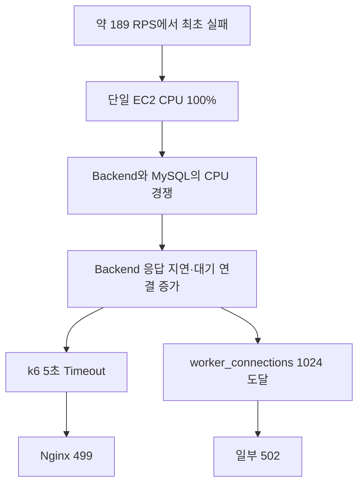

# V1 부하테스트 결과

- 시험 환경: Develop 단일 `t3.medium` EC2
- 시험 일자: 2026-10-01~2026-10-02
- 부하 발생기: MacBook, k6 `v2.3.0`
- 결과 성격: **READ 중심 Release Capacity 검증**

## 결론부터 보기

V1은 READ 중심 혼합 부하 **30 RPS를 20분간 오류 없이 처리**했고, 짧은 **60 RPS Spike**도
통과한 뒤 자동 회복했습니다. Stress에서는 약 **189 RPS부터 실패가 시작**됐고 약 204 RPS에서
안전 중단했습니다. 189 RPS는 안전 용량이 아니라 최초 실패가 관측된 지점입니다.

이번 결과로 확인한 V1 Release Capacity는 **시험에 포함된 조회·검증 중심 혼합 Workload 30 RPS**입니다.
로그인, 회원가입, 실제 선물 생성처럼 Business Data를 만드는 WRITE API는 용량 시험을 수행하지
않았으므로, V1의 WRITE 처리량이나 선물 생성 TPS는 아직 알 수 없습니다.

## 시험 범위: READ 중심이며 WRITE 용량은 미검증

최종 Smoke·API Baseline·혼합 시험에는 핵심 9개 Endpoint가 포함됐습니다. HTTP Method만으로
READ와 WRITE를 구분하지 않고, 실제로 Business Data를 생성·변경하는지를 함께 봅니다.

| 기능 | 요청 | 혼합 비율 | 상태 변경 여부 | 최종 용량 시험 |
|---|---|---:|---|---|
| 상품 목록 | `GET /api/products?sort=POPULAR` | 30% | 조회 | 포함 |
| 상품 상세 | `GET /api/products/{productId}` | 25% | 조회 이력·조회수 기록 | 포함 |
| 사용자 Profile | `GET /api/users/me` | 10% | 조회 | 포함 |
| 친구 목록 | `GET /api/friends` | 10% | 조회 | 포함 |
| 받은 선물 목록 | `GET /api/gifts/received` | 10% | 조회 | 포함 |
| 상품 카테고리 | `GET /api/products/categories` | 5% | 조회 | 포함 |
| 친구 검색 | `GET /api/friends/search` | 5% | 조회 | 포함 |
| 받은 선물 상세 | `GET /api/gifts/received/{giftId}` | 4% | 조회 | 포함 |
| 선물 사전 검증 | `POST /api/gifts/preflight` | 1% | 읽기 전용 검증 | 포함 |

`POST /api/gifts/preflight`는 POST 요청이지만, 수신자·친구 관계·상품·재고·비선호 카테고리를
조회해 선물 가능 여부를 계산할 뿐 선물이나 재고를 변경하지 않습니다. 따라서 WRITE 처리량 증거로
사용하지 않습니다.

상품 상세는 GET 요청이지만 정상 조회 후 사용자별 조회 이력과 상품 조회수를 기록합니다. 그러므로
이번 시험이 Database Write를 전혀 발생시키지 않았다고 표현해서는 안 됩니다. 다만 선물 생성처럼
여러 Business Entity와 재고를 변경하는 핵심 WRITE Transaction을 검증한 시험도 아닙니다.

### 수행하지 않은 WRITE 시험

| API·기능 | 상태 | 제외 이유 | 아직 확인하지 못한 것 |
|---|---|---|---|
| 로그인 | 미실행 | Rate Limit, Session과 Token 수명주기 | 로그인 TPS, Session Row 증가, Rate Limit 동작 |
| 회원가입 | 미실행 | Test Account 생성·삭제 절차 미정 | 계정 생성 TPS, 중복 가입, 개인정보 정리 |
| 실제 선물 생성 `POST /api/gifts` | Script만 존재, 최종 시험 미실행 | 재고 소진, 중복·복구 문제 | 선물 생성 TPS, 재고 정합성, 중복·유실, 멱등성 |
| 그 외 상태 변경 API | 미실행 | Fixture·Cleanup 범위 미정 | Transaction·Lock·Rollback·복구 특성 |

실제 선물 생성 Script가 저장소에 존재한다는 사실은 시험 완료 증거가 아닙니다. 최종 결과에는
`POST /api/gifts` 요청이 없으며, 선물 생성 성공 건수와 TPS도 측정되지 않았습니다.

## 시험 환경과 데이터

요청은 다음 경로로 전달됐습니다.

```text
Mac k6
  → HTTPS / Host Nginx
  → Frontend Container Nginx
  → Backend Container
  → MySQL Container / Docker Volume
```

Backend와 MySQL은 같은 단일 EC2의 CPU와 Memory를 공유했습니다.

| 항목 | 규모 |
|---|---:|
| Test 사용자 | 500명 |
| 친구 관계 | 5,689건 |
| 완료된 받은 선물 | 4,864건 |
| 상품 | 4,231건 |

| Persona | 사용자 | 친구/사용자 | 받은 선물/사용자 |
|---|---:|---:|---:|
| Light | 250명 | 1~3 | 1~2 |
| Normal | 200명 | 5~15 | 3~10 |
| Heavy | 50명 | 30~100 | 30~100 |

보호 API는 Access Token으로 호출했습니다. 최종 시험에서는 로그인 API를 반복 호출하지 않고 기존
Test Token의 사용자 ID와 Backend의 HS256 계약을 사용해 시험 시작 시 Token을 생성했습니다.
따라서 인증된 요청은 검증했지만 로그인 API 자체의 성능은 검증하지 않았습니다.

## 합격 기준

| 지표 | Baseline·Capacity·Spike Gate |
|---|---:|
| 요청 성공률 | 99.5% 초과 |
| p95 응답시간 | 500ms 미만 |
| p99 응답시간 | 1초 미만 |
| Business Error | 0.5% 미만 |
| Dropped Iteration | 0 |
| 요청 Timeout | 5초 |

HTTP Status만 확인하지 않고 응답 JSON의 핵심 구조도 검사했습니다. 예를 들어 상품 목록은
`data.products`가 배열인지, 사용자 Profile은 유효한 `userId`가 있는지 함께 확인했습니다.

## API별 Baseline 결과

각 API에 5 RPS를 5분 동안 주입했습니다.

| API | 요청 | 평균 | p95 | p99 | 최대 | 실패·Drop |
|---|---:|---:|---:|---:|---:|---:|
| 상품 카테고리 | 1,500 | 36.26ms | 99.28ms | 113.71ms | 735.22ms | 0 |
| 상품 목록 | 1,501 | 60.84ms | 118.42ms | 176.25ms | 1,510.15ms | 0 |
| 상품 상세 | 1,500 | 30.84ms | 97.48ms | 110.04ms | 265.26ms | 0 |
| 사용자 Profile | 1,501 | 29.70ms | 94.66ms | 107.86ms | 277.95ms | 0 |
| 친구 목록 | 1,501 | 24.78ms | 90.56ms | 100.38ms | 116.65ms | 0 |
| 친구 검색 | 1,501 | 24.07ms | 87.40ms | 99.92ms | 128.64ms | 0 |
| 받은 선물 목록 | 1,501 | 35.29ms | 102.61ms | 120.46ms | 147.68ms | 0 |
| 받은 선물 상세 | 1,500 | 26.61ms | 93.62ms | 106.56ms | 146.48ms | 0 |
| 선물 사전 검증 | 1,500 | 27.94ms | 94.02ms | 110.97ms | 327.94ms | 0 |

9개 API가 모두 Baseline Gate를 통과했습니다. 상품 목록의 최대 1.51초는 p99 밖의 소수 이상치이며,
실패나 Timeout은 아니었습니다.

## 혼합 Baseline·Capacity·Spike·Stress 결과

| 시험 | 주입 형태 | 요청 | 평균 RPS | 실패율 | p95 | p99 | Drop | 판정 |
|---|---|---:|---:|---:|---:|---:|---:|---|
| Baseline | 5 RPS·5분 | 1,501 | 5.00 | 0% | 108.52ms | 143.55ms | 0 | 통과 |
| Capacity | 5→10→30, 30 RPS 20분 | 45,510 | 23.70 | 0% | 103.39ms | 124.07ms | 0 | 통과 |
| Spike | 5→60→5 RPS | 5,225 | 18.01 | 0% | 105.45ms | 126.13ms | 0 | 통과·회복 |
| Stress | 30→60→100→200… | 55,055 | 75.63 | 5.12% | 4.87초 | 5.00초 | 490 | 약 204 RPS에서 중단 |

평균 RPS는 상승·하강 구간을 모두 포함합니다. Capacity 평균 23.70 RPS가 최대 처리량이라는 뜻이
아니며, 30 RPS 지속 구간을 20분간 별도로 유지했습니다. Spike의 60 RPS도 짧은 급증 검증이므로
60 RPS를 장시간 보장한다는 의미가 아닙니다.

## 혼합 API 비율의 한계

| API | 설정 비율 |
|---|---:|
| 상품 목록 | 30% |
| 상품 상세 | 25% |
| 사용자 Profile | 10% |
| 친구 목록 | 10% |
| 받은 선물 목록 | 10% |
| 상품 카테고리 | 5% |
| 친구 검색 | 5% |
| 받은 선물 상세 | 4% |
| 선물 사전 검증 | 1% |

이 비율은 Access Log나 Product Analytics에서 얻은 실측값이 아니라 V1 기능 중요도에 따른
**가설**입니다. 또한 혼합 시험은 고정된 친구·선물 ID의 일관성을 위해 Test1 사용자 Token 하나를
사용했습니다. 따라서 서로 다른 관계와 Data를 가진 다수 사용자의 현실적인 행동을 완전히 재현한
시험은 아닙니다.

## Stress에서 확인한 병목

최초 실패는 시작 약 11분 41초 후 계획 Rate 약 189 RPS에서 발생했고, 실패율 안전 기준을 넘은
약 204 RPS에서 시험이 중단됐습니다.



| 관측 항목 | 결과 |
|---|---:|
| 완료 요청 | 55,055건 |
| 실패 요청 | 2,820건 |
| Request Timeout | 2,788건 |
| Connection Reset | 21건 |
| HTTP 502 | 8건 |
| EOF | 3건 |
| Host CPU | 최대 100% |
| Backend CPU | 평균 38.93%, 최대 120.56% |
| MySQL CPU | 평균 28.14%, 최대 75.32% |
| Host Nginx 499 | 3,727건 |
| Host Nginx 502 | 8건 |
| MySQL 200ms 이상 Slow Query | 0건 |
| Container Restart·OOM | 0건 |
| 시험 후 Health | HTTP 200, 17.74ms |

첫 번째 구조적 한계는 단일 EC2의 공유 CPU와 Backend 처리 대기입니다. Nginx
`worker_connections 1024`는 요청이 쌓인 뒤 나타난 두 번째 한계이므로 Connection 수만 늘려서는
근본 문제가 해결되지 않습니다.

## 결과로 말할 수 있는 것과 없는 것

### 확인한 것

- 9개 조회·검증 API의 5 RPS Baseline 성공률 100%
- READ 중심 혼합 30 RPS 지속 구간 성공률 100%
- 짧은 60 RPS Spike 성공률 100%와 자동 회복
- 단일 EC2 공유 CPU 구조에서 약 189 RPS부터 실패
- 과부하 종료 후 Container 재시작 없이 Health 회복

### 확인하지 못한 것

- 로그인·회원가입 처리량
- 실제 선물 생성 TPS
- 선물 생성 시 재고의 정확성, 중복·유실 방지와 멱등성
- WRITE 동시성에서 발생하는 DB Lock·Transaction Rollback·Connection Pool 특성
- 60 RPS 장시간 지속 처리
- 실제 사용자 API 비율과 다중 사용자 관계 Data 분포
- rolling 30일 가용성 SLO 달성
- V2 목표 600 RPS 처리

## WRITE 부하테스트를 위한 선행 조건

WRITE 시험은 응답시간만 빠르면 통과하는 시험이 아닙니다. 성능과 Business Data 무결성을 함께
검증해야 하므로 다음 준비가 필요합니다.

1. Production과 분리된 Develop DB와 전용 Test Account를 사용합니다.
2. Test Run ID로 생성 Data를 식별할 수 있게 합니다.
3. 시험 전 DB Backup 또는 Snapshot과 검증된 Restore 절차를 준비합니다.
4. VU별 Sender·Recipient와 충분한 상품 재고를 준비합니다.
5. 동일 Idempotency Key 재시도와 서로 다른 Key의 동시 요청을 분리해 시험합니다.
6. 성공 응답 수뿐 아니라 재고 감소량, 선물 이력 수와 중복 Row가 없는지 대조합니다.
7. DB Connection, Lock Wait, Deadlock, Transaction Rollback과 Hikari Pending을 수집합니다.
8. 정상 종료와 중도 실패 모두에 사용할 Cleanup·Reset 절차를 검증합니다.
9. Smoke → 낮은 Write Baseline → 동시성 시험 → Spike 순서로 부하를 높입니다.
10. READ 30 RPS 결과를 WRITE 30 TPS 보장으로 환산하지 않습니다.

WRITE 시험 전에는 최소한 다음 성공 조건을 별도로 합의해야 합니다.

| 영역 | 성공 조건 예시 |
|---|---|
| HTTP | 기대 Status와 오류율 기준 충족 |
| Latency | Write 전용 p95·p99 기준 충족 |
| 멱등성 | 같은 Key 재시도에서 선물 1건만 생성 |
| 재고 | 성공 수량만큼 정확히 감소하고 음수가 되지 않음 |
| 이력 | 성공 응답과 Gift History Row 수가 일치 |
| 동시성 | Deadlock·중복·유실이 없거나 정의한 Retry로 복구 |
| 복구 | 시험 후 Backup Restore 또는 Cleanup 검증 통과 |

## V2로 가져갈 요구사항

1. Backend와 MySQL의 Compute 자원을 분리합니다.
2. Backend 수평 확장과 Load Balancer를 검토합니다.
3. Backend Thread·Hikari Connection Pool과 DB Connection을 관측합니다.
4. 실제 Access Log나 Product Analytics로 혼합 API 비율을 교체합니다.
5. 사용자별 친구·선물 ID를 사용하는 다중 사용자 Journey를 만듭니다.
6. V1과 같은 READ Scenario를 V2에서 반복해 구조 변경 전후를 비교합니다.
7. 실제 선물 생성은 멱등성·재고·중복·유실·복구를 포함한 별도 WRITE Scenario로 검증합니다.
8. READ Release Capacity와 WRITE TPS를 분리해 문서화합니다.

## 결과 자료 위치

| 자료 | 저장소 경로 |
|---|---|
| 통합 시각화 | `load-tests/results/v1-load-test-visual-report.html` |
| 최종 상세 보고서 | `load-tests/handoff/v1/v1-load-test-final-report.md` |
| API별 k6 HTML | `load-tests/handoff/v1/api-baselines/` |
| 혼합 k6 HTML | `load-tests/handoff/v1/mixed/` |
| k6 Summary·Raw Metric | `load-tests/results/<TEST_ID>/` |
| k6 Scenario | `load-tests/k6/` |

관련 운영 목표와 Release Gate의 차이는 [[V1 SLI와 SLO|V1-SLI-SLO]]에서 확인할 수 있습니다.
